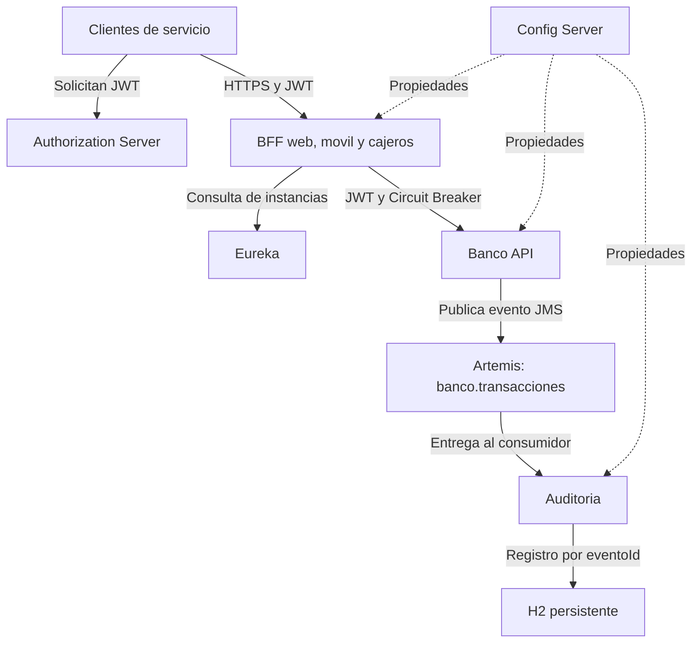

# Banco XYZ: microservicios y resiliencia con Spring Cloud

**Asignatura:** Desarrollo Backend III, PBY2203  
**Actividad:** Exp3, semana 8, Sumativa 3  
**Estudiante:** Miguel Cabrillana Sanhueza  
**Profesor:** Jose Luis Martinez Opazo

## Objetivo y alcance

Preparar el backend de Banco XYZ como una aplicacion distribuida con autenticacion OAuth2, configuracion central, descubrimiento de servicios, tolerancia a fallos y comunicacion asincrona. Cada componente se ejecuta en un contenedor y Docker Compose coordina el conjunto.

Se reutilizan la API de datos CSV y los tres BFF de la Sumativa 2. La entrega incorpora los componentes necesarios de Spring Cloud en este mismo proyecto; las semanas 6 y 7 se utilizan como material de apoyo.

Los datos originales de `banco-api/src/main/resources/data/` se conservan: `cuentas_anuales.csv`, `intereses.csv` y `transacciones.csv`. Fuente del caso: [bank_legacy_data](https://github.com/KariVillagran/bank_legacy_data). Contienen fechas y campos heterogeneos; esta entrega no agrega un proceso de limpieza de datos.

## Propuesta tecnica

Se mantiene un BFF para cada canal porque web, movil y cajeros necesitan respuestas diferentes. Los tres descubren `banco-api` mediante Eureka, envian el JWT recibido y protegen la llamada con Spring Cloud Circuit Breaker y Resilience4j.

Spring Authorization Server autentica clientes de servicio y emite JWT firmados. Se utiliza `client_credentials` porque se demuestra comunicacion entre clientes de servicio y APIs, sin implementar una interfaz de inicio de sesion de personas. Las APIs validan firma, emisor, vigencia, audiencia y permisos.

Config Server centraliza los parametros comunes y la configuracion de resiliencia. Se utiliza su repositorio nativo incluido en `config-repo/` para que la entrega sea reproducible sin depender de un repositorio externo de configuraciones. Config Server y Eureka requieren autenticacion Basic.

La API publica un evento de una transaccion existente en una cola JMS de ActiveMQ Artemis. `auditoria-service` consume el evento y lo registra en una base H2 persistente. La API puede aceptar eventos aunque el consumidor este detenido, siempre que el broker este disponible.

Docker Compose incluye los ocho servicios Java y el broker, una red interna, comprobaciones de salud, dependencias de arranque y volumenes para la cola y la auditoria. Los servicios Java se ejecutan con un usuario sin privilegios. Esta entrega fue ejecutada localmente con Docker; no declara un despliegue en un proveedor de nube.



## Estructura y componentes

| Directorio o servicio | Funcion | Acceso desde Ubuntu |
|---|---|---|
| `banco-api/` | Consulta CSV y publica eventos | `http://localhost:8100` |
| `bff-web/` | Respuestas del canal web | `https://localhost:8101` |
| `bff-movil/` | Respuestas reducidas para movil | `https://localhost:8102` |
| `bff-cajeros/` | Consultas de saldo y retiros | `https://localhost:8103` |
| `auth-server/` | Emision OAuth2 y claves publicas JWKS | `http://localhost:9000` |
| `config-server/` | Configuracion central | `http://localhost:8888` |
| `discovery-server/` | Registro Eureka | `http://localhost:8761` |
| `auditoria-service/` | Consume JMS y consulta eventos procesados | `http://localhost:8104` |
| `broker` en Compose | ActiveMQ Artemis; JMS interno en `broker:61616` | Consola `http://localhost:8161` |
| `scripts/` | Preparacion, arranque, detencion y verificacion | Desde la raiz del proyecto |
| `evidencias/semana8/` | Salidas, registros y resultados de las pruebas | Archivos de esta entrega |

Cada servicio Java contiene `pom.xml`, `src/`, `Dockerfile` y `.dockerignore`. El `pom.xml` raiz coordina los ocho modulos. Las configuraciones compartidas estan en `config-server/src/main/resources/config-repo/`.

Tecnologias: Java 17, Spring Boot 3.5.16, Spring Cloud 2025.0.3, Spring Security, Spring Authorization Server, Resilience4j, Spring JMS, Artemis 2.40.0, H2, Maven y Docker Compose.

## Requisitos y ejecucion

Se necesitan Java 17, Maven, Python 3, Docker operativo y Docker Compose v2. La compilacion inicial y las imagenes requieren internet. Los puertos de la tabla deben estar libres. El equipo utilizado tenia aproximadamente 5,7 GiB de RAM disponible antes del trabajo; los servicios tienen limites de memoria en Compose.

Desde la carpeta que contiene este README:

```bash
bash scripts/iniciar.sh
docker compose -p banco-xyz-s8 ps
```

El script crea `.env` con secretos aleatorios si faltan, compila los JAR, construye las ocho imagenes y espera el estado saludable de los nueve contenedores. No requiere descargar los scripts de desarrollo utilizados durante la construccion de la actividad.

Las variables son `AUTH_WEB_SECRET`, `AUTH_MOVIL_SECRET`, `AUTH_CAJEROS_SECRET`, `INFRA_SECRET` y `JMS_PASSWORD`. `.env` se mantiene local y se excluye de Git y de la entrega. El usuario de Config Server y Eureka es `infra`; el del broker es `banco`. Sus claves se obtienen del `.env` local, sin valores predeterminados compartidos.

Los puertos publicados se vinculan a `127.0.0.1`. Dentro de Docker, los componentes utilizan nombres de servicio y no `localhost`. El emisor JWT es `http://localhost:9000`; los servicios consultan las claves publicas por `http://auth-server:9000/oauth2/jwks`.

Para revisar registros o detener la aplicacion:

```bash
docker compose -p banco-xyz-s8 logs --tail=80 banco-api auditoria-service
bash scripts/detener.sh
```

La detencion conserva los volumenes. Mantener tambien `.env` permite volver a usar las credenciales del broker persistido.

## Seguridad OAuth2

| Cliente | Permisos disponibles |
|---|---|
| `cliente-web` | `banco.read`, `canal.web`, `transacciones.write` |
| `cliente-movil` | `banco.read`, `canal.movil` |
| `cliente-cajeros` | `banco.read`, `canal.cajeros`, `transacciones.write` |

Los JWT tienen vigencia de cinco minutos, firma RSA y audiencia `banco-xyz`. Cada BFF exige el permiso de su canal; la API de lectura exige `banco.read` y la publicacion de eventos exige `transacciones.write`. Los tokens fijos de la entrega anterior fueron reemplazados.

Ejemplo desde Bash en la raiz del proyecto, con los contenedores activos:

```bash
set -a
source .env
set +a
TOKEN_WEB=$(curl -fsS -u "cliente-web:${AUTH_WEB_SECRET}" \
  --data-urlencode "grant_type=client_credentials" \
  --data-urlencode "scope=banco.read canal.web transacciones.write" \
  http://localhost:9000/oauth2/token \
  | python3 -c 'import json,sys; print(json.load(sys.stdin)["access_token"])')
curl -kfsS -H "Authorization: Bearer ${TOKEN_WEB}" \
  "https://localhost:8101/web/intereses?cuentaId=137"
curl -i -X POST -H "Authorization: Bearer ${TOKEN_WEB}" \
  "http://localhost:8100/api/transacciones/1/eventos"
```

El primer recurso devuelve HTTP 200 y el segundo HTTP 202 con el `eventoId`. Para consultar el procesamiento se usa `GET /auditoria/eventos/{eventoId}` en el puerto 8104, con el mismo JWT. Si el token vence, se solicita otro.

Sin token se obtiene HTTP 401. Con un token valido pero sin el permiso requerido se obtiene HTTP 403. El parametro `-k` solo corresponde al certificado autofirmado de los BFF usado en esta demostracion.

## Endpoints de negocio

| Servicio | Metodo y ruta | Funcion |
|---|---|---|
| API | `GET /api/cuentas?cuentaId=137` | Consulta de cuentas |
| API | `GET /api/intereses?cuentaId=137` | Consulta de intereses |
| API | `GET /api/transacciones` | Transacciones del CSV |
| API | `POST /api/transacciones/{id}/eventos` | Publica un evento de una transaccion existente |
| Web | `GET /web/cuentas`, `/web/intereses`, `/web/transacciones` | Datos del canal web; los dos primeros admiten `cuentaId` |
| Movil | `GET /movil/cuentas/{cuentaId}`, `/movil/transacciones` | Respuestas adaptadas a movil |
| Cajeros | `GET /cajeros/saldo/{cuentaId}`, `/cajeros/retiros/{cuentaId}` | Consultas del canal cajeros |
| Auditoria | `GET /auditoria/eventos`, `/auditoria/eventos/{eventoId}` | Eventos efectivamente procesados |

El endpoint de publicacion no ejecuta un movimiento bancario ni modifica saldos. Publica una referencia y los datos de una transaccion del CSV para demostrar la comunicacion orientada a eventos.

## Tolerancia a fallos

Los tres BFF utilizan el circuito `bancoApi`. Su ventana es de cuatro llamadas, requiere cuatro llamadas para evaluar el porcentaje y abre con al menos 50 % de fallos. Permanece abierto cinco segundos y permite dos llamadas de prueba en estado semiabierto. El tiempo limite es de cuatro segundos; los limites HTTP son 1,5 segundos de conexion y 2,5 segundos de lectura.

Durante una caida, el fallback devuelve HTTP 503, estado `DEGRADADO` y una indicacion para reintentar. No construye datos bancarios sustitutos. Los errores HTTP de cliente se conservan y no se contabilizan como fallos de disponibilidad. Al recuperarse la API, el circuito pasa a `CLOSED`.

## Mensajeria JMS

El productor utiliza `JmsTemplate` para enviar JSON como `TextMessage` persistente a `banco.transacciones`. Solo responde HTTP 202 despues del envio al broker. Si no se puede publicar, responde HTTP 503 con estado `NO_ENCOLADO`; una transaccion inexistente produce HTTP 404.

El consumidor utiliza `@JmsListener` y una transaccion de base de datos. Registra `eventoId`, `transaccionId`, tipo, contenido y fecha de procesamiento. `eventoId` es clave primaria y permite ignorar la entrega repetida del mismo evento. Se utiliza procesamiento con posible reentrega; no se promete una entrega exactamente una vez ni una transaccion distribuida.

Los volumenes `broker-data` y `auditoria-data` conservan respectivamente el estado del broker y la base H2. La prueba realizada detiene el consumidor, publica otro evento, reinicia el consumidor y comprueba su procesamiento y la conservacion del evento previo en H2. La supervivencia a una eliminacion de volumenes no forma parte de la prueba.

## Verificacion y evidencias

Las salidas reales se incluyen en [evidencias/semana8/README.md](evidencias/semana8/README.md). Se comprobaron 18 pruebas HTTP de OAuth2, 20 comprobaciones de Spring Cloud y resiliencia y 25 comprobaciones de Docker y JMS. Las dos primeras etapas se ejecutaron con JVM locales; la ultima se ejecuto sobre los nueve contenedores.

Para repetir las pruebas integradas con Docker ya activo:

```bash
python3 scripts/verificar_docker.py
```

Esta prueba emite tokens, comprueba los BFF y Eureka, publica eventos y detiene temporalmente `auditoria-service` y `banco-api` para verificar la cola y el circuito. Luego los reinicia y deja los nueve contenedores activos. Actualiza los archivos `05_*` de evidencias. La compilacion usa `-DskipTests`; los resultados incluidos corresponden a pruebas de integracion HTTP/JMS ejecutadas por los scripts.

Adicionalmente, el ajuste final de Eureka paso ocho comprobaciones dirigidas: autenticacion, cinco clientes registrados, consultas de los tres BFF, ausencia de replicacion propia y salud de los contenedores. El detalle esta en [07_revision_eureka.txt](evidencias/semana8/07_revision_eureka.txt).

| Criterio de la pauta | Puntos | Implementacion y evidencia |
|---|---:|---|
| OAuth2 funcional | 20 | `auth-server/`, seguridad de API/BFF/auditoria; `03_pruebas_oauth2.txt` y pruebas de acceso de `05_pruebas_docker_jms.txt` |
| Imagenes Docker para todos los microservicios | 20 | Ocho Dockerfiles; `05_construccion_imagenes.log` y `05_imagenes_docker.txt` |
| Orquestacion completa con Compose | 20 | `docker-compose.yaml`, salud y dependencias; `05_estado_docker.txt` |
| Resilience4j | 20 | `BancoClient`, `ResilienceErrorHandler` y configuracion central en los tres BFF; `04_pruebas_cloud_resiliencia.txt` y prueba Docker del canal web |
| Kafka o JMS | 15 | Productor en `banco-api/`, consumidor en `auditoria-service/`, broker Artemis; `05_pruebas_docker_jms.txt` y `05_evento_*.json` |
| Codigo, documentacion y evidencias | 5 | Modulos, este README con propuesta tecnica, scripts, repositorio y `evidencias/semana8/` |

Las rutas de evidencia de la tabla son relativas a `evidencias/semana8/`. Los puntajes corresponden a la pauta, no a una calificacion asignada.

## Limites de la demostracion y paso a nube

Se ejecuta una instancia por servicio. Eureka descubre la API, pero el cliente toma la primera instancia; no se ha implementado balanceo entre varias replicas. H2 en archivo es suficiente para la auditoria local y no demuestra escalado horizontal de su base de datos.

Las claves RSA del servidor OAuth2 y sus clientes se inicializan en memoria. Reiniciar ese servidor cambia la clave de firma: se deben obtener tokens nuevos. Los BFF incluyen un certificado autofirmado con clave de demostracion; los servicios internos y el servidor OAuth2 utilizan HTTP dentro del entorno local.

Para un despliegue real se deberian configurar nombres y certificados validos, HTTPS externo, almacenamiento estable de claves OAuth2 y secretos, una base de auditoria adecuada, acceso restringido a infraestructura y observabilidad. La autopreservacion de Eureka esta desactivada y sus tiempos son breves para permitir la demostracion de fallos. No se presenta esta configuracion como un sistema bancario productivo.

## Referencias tecnicas

- [Spring Cloud](https://spring.io/projects/spring-cloud)
- [Spring Authorization Server](https://docs.spring.io/spring-authorization-server/reference/index.html)
- [OAuth2 Resource Server JWT](https://docs.spring.io/spring-security/reference/servlet/oauth2/resource-server/jwt.html)
- [Spring Cloud Circuit Breaker y Resilience4j](https://docs.spring.io/spring-cloud-circuitbreaker/reference/spring-cloud-circuitbreaker-resilience4j.html)
- [Spring Boot: mensajeria JMS](https://docs.spring.io/spring-boot/3.5/reference/messaging/jms.html)
- [Artemis 2.40.0 en Docker](https://artemis.apache.org/components/artemis/documentation/previous/2.40.0/docker.html)
- [Orden de arranque en Docker Compose](https://docs.docker.com/compose/how-tos/startup-order/)

## Repositorio

[Repositorio del proyecto](https://github.com/mcabri84/pby2203-exp3-s8-banco-xyz-bff)

La rama principal es `main`. El codigo, configuraciones, documentacion y evidencias incluidos en el ZIP corresponden a los archivos publicados en esa rama.
